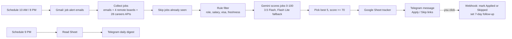

# Automation n8n AI Job Hunter

An AI job-search assistant built with **n8n**, **Google Gemini**, **Gmail**, **Google Sheets** and **Telegram**.

Twice a day it does the following:

1. Collects new jobs from job-alert emails, remote job boards and company careers pages.
2. Filters them against personal rules: role, salary floor, location and visa sponsorship.
3. Has Gemini score each remaining job 0–100 against your resume.
4. Sends the best 5 to Telegram with **Apply** and **Skip** links.

Every job is logged in a Google Sheet, and a 9 PM digest summarises the day. Nothing is applied for you: every application is your decision. It runs entirely on free tiers.



## Results from the first live run

565 jobs collected → 32 passed the rules → Gemini scored them → 5 sent (scores 83–92), in about 2 minutes.

## Features

- **Allowed sources only**:
  - job-alert emails (LinkedIn, Naukri, Instahyre, Cutshort, Wellfound) read through the Gmail API;
  - public feeds (Remotive, RemoteOK, Himalayas, WeWorkRemotely);
  - public Greenhouse, Lever and Ashby job-board APIs.
  - No scraping, no auto-apply.
- **Rule engine** in plain JavaScript:
  - target roles and excluded titles;
  - experience cap;
  - salary floors by location and company type;
  - visa sponsorship required for overseas roles;
  - target companies ranked first.
- **One Gemini call per run**: up to 40 jobs in a single prompt, which keeps it well inside the free tier. A fallback model takes over automatically if the main one is busy.
- **Deduplication**: each job is scored once ever (n8n Remove Duplicates), and Sheet rows are upserted by Job ID.
- **Human in the loop**: an Apply/Skip webhook updates the tracker and opens the posting.
- **Daily digest**: found, applied, skipped, pending, and follow-ups due.

## Tech stack

n8n 2.x (self-hosted) · Node.js 22 · pm2 · Google Gemini API (AI Studio) · Google Cloud OAuth 2.0 · Gmail API · Google Sheets API · Telegram Bot API · JavaScript

## Repository layout

| Path | What it is |
| --- | --- |
| `workflows/wf1_job_hunter.json` | Main workflow: collect, filter, score, log, send |
| `workflows/wf2_apply_skip.json` | Webhook that handles Apply/Skip clicks |
| `workflows/wf3_digest.json` | 9 PM Telegram digest |
| `src/*.js` | The Code-node scripts, readable on their own |
| `docs/SETUP.md` | Full step-by-step setup guide |

## Quick start

1. Install Node 22, then start n8n:
   ```
   npm install -g pm2
   NODE_OPTIONS="--dns-result-order=ipv4first" pm2 start "npx n8n" --name n8n
   pm2 save && pm2 startup
   ```
2. Open http://localhost:5678 and create four credentials:
   - Google Gemini (API key from aistudio.google.com)
   - Gmail OAuth2
   - Google Sheets OAuth2 (Gmail and Sheets use the same Google Cloud OAuth client)
   - Telegram (bot token from @BotFather)
3. Create a Google Sheet with the 17 headers listed in `docs/SETUP.md`.
4. Import the three files in `workflows/`. Then:
   - select your credentials in each node;
   - replace `YOUR_GOOGLE_SHEET_ID` and `YOUR_TELEGRAM_CHAT_ID`;
   - edit `RULES` and `profile` in the *Filter & build prompt* node.
5. Set each workflow's timezone, test it, then **Publish**.

The full walkthrough is in [docs/SETUP.md](docs/SETUP.md). It covers:

- Google AI Studio, Google Cloud OAuth and Telegram;
- building every node by hand;
- how a run works;
- troubleshooting.

## Security

These files hold no API keys, tokens or secrets. n8n stores credentials encrypted on your machine, and exported workflows only reference them by name. The Sheet ID and chat ID are placeholders.

## Author

**Abhidhab Mellwyn**

- Portfolio: https://abhidhab-mellwyn.vercel.app
- LinkedIn: https://www.linkedin.com/in/abhidhab-mellwyn/
- GitHub: https://github.com/kva-rules

## License

MIT
